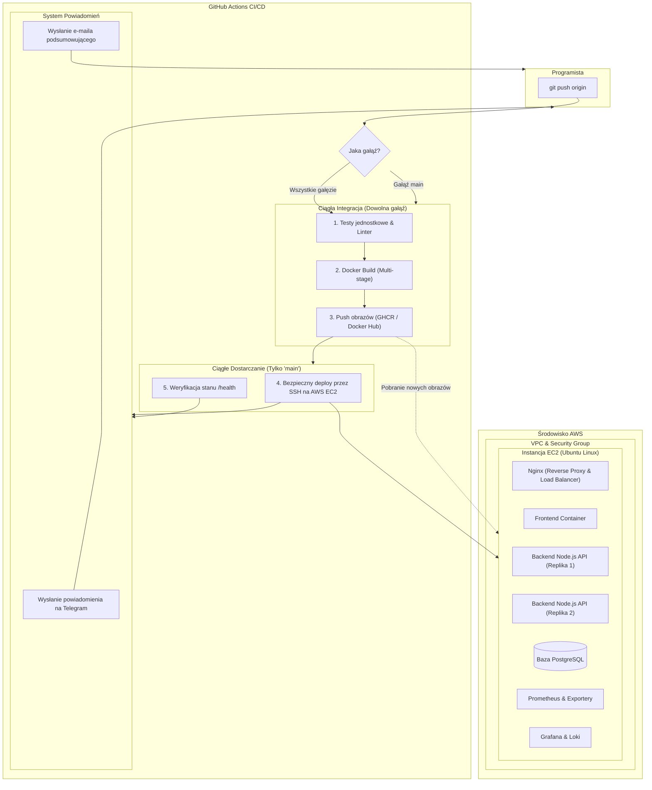

# Plan Techniczny Projektu Dyplomowego DevOps: Beauty Salon App

Niniejszy dokument stanowi ostateczny plan architektoniczny i wykonawczy projektu dyplomowego DevOps, zgodny z ustalonym stosem technologicznym i wymaganiami komisji.

---

## 1. Wybrany Stos Technologiczny i Decyzje Architektoniczne

Na podstawie analizy kryteriów oraz ustaleń przyjęto następujący stos narzędziowy:

* **Infrastruktura (Cloud & IaC)**:
  * Dostawca chmurowy: **AWS** (Amazon Web Services — EC2, VPC, Security Group, Elastic IP).
  * Infrastructure as Code: **Terraform** (zarządzanie zasobami AWS w sposób idempotentny).
  * Konfiguracja węzła: **Ansible** (instalacja Dockera, konfiguracja zabezpieczeń i środowiska uruchomieniowego).
* **Architektura Aplikacji (`Beauty Salon App`)**:
  * **Frontend**: Lekki interfejs SPA (HTML5/TailwindCSS/JS) serwowany przez serwer **Nginx** (katalog usług, cennik, rezerwacja wizyt online).
  * **Backend API**: **Node.js + Express** (REST API, endpointy: `/health`, `/api/services`, `/api/appointments`).
  * **Baza danych**: **PostgreSQL 16 Alpine** (przechowywanie rezerwacji i bazy klientów w kontenerze z wolumenem trwałym).
* **Konteneryzacja & Orkiestracja**:
  * **Docker** (zoptymalizowane obrazy multi-stage build).
  * **Docker Compose** (zarządzanie siecią kontenerową, zmiennymi środowiskowymi i wolumenami).
  * Nginx jako **Reverse Proxy & Load Balancer** (kierowanie ruchu na repliki backendu).
* **CI/CD Pipeline**:
  * **GitHub Actions** (zarządzanie cyklem życia kodu i automatyzacją).
  * Rejestr artefaktów: **GitHub Container Registry (GHCR)** lub **Docker Hub**.
* **Powiadomienia**:
  * **Telegram Bot** (natychmiastowe powiadomienia o statusie testów i wdrożenia na czat/kanał).
  * **E-mail** (raport podsumowujący deployment wysyłany za pośrednictwem akcji SMTP w GitHub Actions).
* **Monitoring i Obserwowalność**:
  * **Prometheus** (zbieranie metryk systemowych i aplikacyjnych).
  * **Node Exporter** (metryki systemu operacyjnego Linux/AWS EC2).
  * **cAdvisor** (metryki zużycia zasobów przez kontenery Dockera).
  * **Grafana** (wizualizacja i interaktywne dashboardy).
  * **Grafana Loki + Promtail** (centralizacja i przeszukiwanie logów kontenerów bez wchodzenia na serwer).
  * **Alertmanager** (reguły alertowe i eskalacja awarii).
* **Język dokumentacji**: **Język polski**.

---

## 2. Diagram Przepływu CI/CD i Wdrożenia na AWS

---

## 3. Plan Implementacji Krok po Kroku

### Krok 1: Struktura i Kod Aplikacji (`beauty-salon-app`)
* Przygotowanie modularnej struktury:
  * `frontend/`: strona salonu piękności z formularzem rezerwacji wizyty.
  * `backend/`: serwer Node.js/Express, obsługa bazy Postgres, endpoint `/health`, endpointy rezerwacji.
  * `docker-compose.yml`: konfiguracja wszystkich kontenerów, sieci i wolumenów.
  * Skrypty testowe dla CI (`npm test` sprawdzający poprawność działania API i połączenia z bazą).

### Krok 2: Infrastruktura jako Kod (Terraform + Ansible)
* Katalog `terraform/`:
  * Konfiguracja dostawcy AWS (`provider.tf`).
  * Tworzenie VPC, podsieci, bramy internetowej i tabeli routingu (`network.tf`).
  * Konfiguracja Security Group: reguły dla portów 22 (SSH), 80/443 (HTTP/HTTPS), 3000 (Grafana) (`security.tf`).
  * Definicja instancji EC2 oraz klucza SSH (`compute.tf`).
  * Zmienne i plik wyjściowy z publicznym adresem IP (`outputs.tf`).
* Katalog `ansible/`:
  * Playbook instalujący Dockera, Docker Compose i konfigurujący firewall UFW.
  * Skrypt weryfikujący gotowość środowiska.

### Krok 3: Pipeline CI/CD w GitHub Actions
* `.github/workflows/ci.yml`:
  * Uruchamiany przy każdym `push` i `pull_request` do dowolnej gałęzi (oprócz main).
  * Kroki: testy, build obrazów Docker, weryfikacja poprawności.
* `.github/workflows/deploy.yml`:
  * Uruchamiany wyłącznie przy `push` do gałęzi `main`.
  * Kroki:
    1. Testy aplikacji.
    2. Budowa i tagowanie obrazów kontenerów (`latest` oraz commit SHA).
    3. Publikacja obrazów w rejestrze GHCR / Docker Hub.
    4. Wdrożenie na serwer AWS EC2 za pośrednictwem protokołu SSH (`appleboy/ssh-action`):
       - Pobranie najnowszych obrazów (`docker compose pull`).
       - Uruchomienie serwisów (`docker compose up -d`).
    5. Sprawdzenie stanu aplikacji (curl na endpoint `/health`).
    6. Wysłanie powiadomienia na Telegram (`appleboy/telegram-action`).
    7. Wysłanie podsumowania na E-mail (`dawidd6/action-send-mail`).

### Krok 4: Stos Obserwowalności (Monitoring, Metryki, Logi)
* `monitoring/prometheus.yml`: konfiguracja zadań zbierania metryk (scraping).
* `monitoring/docker-compose.monitoring.yml`: kontenery Prometheus, Node Exporter, cAdvisor, Grafana, Loki, Promtail.
* Konfiguracja Grafany:
  * Automatycznie dodane źródła danych (Prometheus, Loki).
  * Gotowy dashboard z metrykami serwera AWS i kontenerów aplikacji.

### Krok 5: Dokumentacja Projektowa (po polsku)
* `README.md` — wizytówka projektu, schemat, instrukcja instalacji w 2 krokach.
* `docs/ARCHITEKTURA.md` — opis komponentów, schematy logiczne i sieciowe.
* `docs/IAC_AWS.md` — instrukcja wdrożenia infrastruktury z poziomu Terraform/Ansible.
* `docs/CICD_PIPELINE.md` — opis gałęzi, sekretów w GitHub i automatyzacji.
* `docs/MONITORING_I_LOGI.md` — opis metryk, dostęp do dashboardów Grafana, reguły alertów.
* `docs/INSTRUKCJA_OBRONY.md` — gotowy przewodnik do 15-minutowej prezentacji i obrony przed komisją.

---

## 4. Wymagane Sekrety (GitHub Secrets)

Przed uruchomieniem pipeline'u w repozytorium GitHub zostaną skonfigurowane następujące zmienne:
1. `AWS_ACCESS_KEY_ID` i `AWS_SECRET_ACCESS_KEY` — do Terraform.
2. `EC2_SSH_KEY` — klucz prywatny do logowania na serwer AWS.
3. `EC2_HOST` — publiczny adres IP instancji EC2.
4. `TELEGRAM_BOT_TOKEN` i `TELEGRAM_CHAT_ID` — do powiadomień Telegram.
5. `SMTP_USERNAME`, `SMTP_PASSWORD`, `SMTP_SERVER`, `NOTIFICATION_EMAIL` — do powiadomień e-mail.
