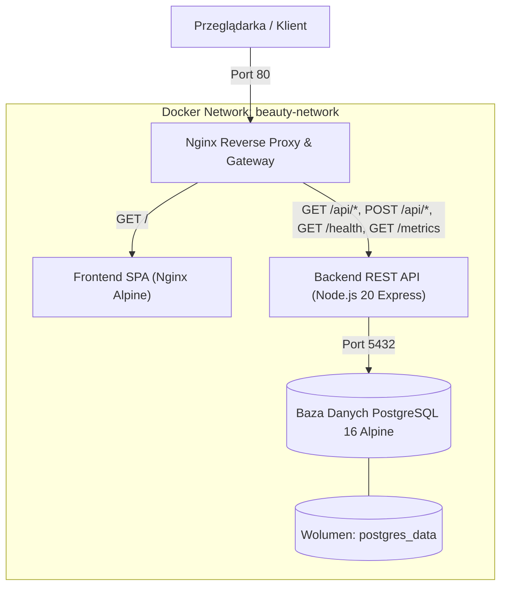

# Bellezza Studio — Beauty Salon App

> Kompleksowy projekt aplikacji salonu urody i spa przygotowany w ramach projektu dyplomowego DevOps (AWS, Docker, CI/CD GitHub Actions, Prometheus, Grafana).

[](https://nodejs.org/)
[](https://www.docker.com/)
[](https://www.postgresql.org/)
[](https://nginx.org/)
[](https://prometheus.io/)

---

## 1. Architektura Systemu

Aplikacja oparta jest na nowoczesnej, skonteneryzowanej architekturze modularnej:



### Komponenty Aplikacji:
1. **Frontend SPA (`frontend/`)**: Estetyczny, responsywny interfejs dla salonu urody („Bellezza Studio”) zrealizowany w HTML5 + Tailwind CSS z dynamicznym cennikiem usług, panelem rezerwacji wizyt online oraz podglądem harmonogramu. Serwowany przez lekki kontener `nginx:alpine` z kompresją gzip.
2. **Backend REST API (`backend/`)**: Skalowalny mikroserwis w Node.js/Express:
   - Pula połączeń z PostgreSQL (`pg`).
   - Endpoint `/health` weryfikujący stan procesu oraz aktywne połączenie z bazą (zwraca kod 200 lub 503 pod weryfikację CI/CD po wdrożeniu).
   - Endpoint `/metrics` dla Prometheusa (`prom-client`).
   - Bezpieczeństwo i nagłówki HTTP (`helmet`, `cors`).
   - Konteneryzacja multi-stage build z nieuprzywilejowanym użytkownikiem `node`.
3. **Baza Danych (`db/`)**: PostgreSQL 16 Alpine z automatyczną inicjalizacją schematu (`init.sql`), relacjami (`services`, `appointments`), indeksami oraz danymi początkowymi (5 usług w języku polskim). Trwałość danych gwarantowana przez wolumen Dockera.
4. **Nginx Reverse Proxy / API Gateway (`nginx/`)**: Pojedynczy punkt wejścia do aplikacji na porcie 80, kierujący ruch do frontendu i backendu, przygotowany na horyzontalne skalowanie kontenerów backendu (`upstream backend_servers`).

---

## 2. Struktura Katalogów

```
beauty-salon-app/
├── .env.example              # Wzór zmiennych środowiskowych
├── .env                      # Aktywne zmienne środowiskowe
├── .gitignore                # Wykluczenia z repozytorium Git
├── docker-compose.yml        # Orkiestracja kontenerów (db, backend, frontend, proxy)
├── PLAN_PROJEKTU.md          # Pełny plan techniczny projektu dyplomowego
├── WYMAGANIA_PROJEKTU.md     # Macierz zgodności z wymaganiami formalnymi
├── db/
│   └── init.sql              # Skrypt inicjalizujący schemat bazy i dane początkowe
├── backend/
│   ├── Dockerfile            # Multi-stage Dockerfile (Node.js 20 Alpine)
│   ├── .dockerignore
│   ├── package.json          # Zależności i skrypty (npm test, npm start)
│   ├── src/
│   │   ├── app.js            # Konfiguracja Express i middleware
│   │   ├── server.js         # Uruchomienie serwera i graceful shutdown
│   │   ├── db.js             # Pula połączeń i healthcheck PostgreSQL
│   │   ├── middleware/
│   │   │   └── metrics.js    # Zbieranie metryk Prometheus (prom-client)
│   │   └── routes/
│   │       ├── health.js     # Endpointy /health oraz /health/live
│   │       ├── services.js   # Katalog usług (/api/services)
│   │       └── appointments.js # Rezerwacje wizyt (/api/appointments)
│   └── tests/
│       ├── health.test.js    # Testy jednostkowe endpointu /health i metryk
│       └── api.test.js       # Testy integracyjne API usług i rezerwacji
├── frontend/
│   ├── Dockerfile            # Konteneryzacja Nginx Alpine
│   ├── .dockerignore
│   ├── nginx.conf            # Konfiguracja serwowania SPA i kompresji gzip
│   └── src/
│       ├── index.html        # Główny interfejs salonu Bellezza Studio
│       ├── styles.css        # Dodatkowe style, animacje i toasty
│       └── app.js            # Dynamiczne pobieranie usług i rezerwacja wizyt
├── nginx/
│   ├── Dockerfile            # Obraz Reverse Proxy Gateway
│   └── default.conf          # Konfiguracja routingu i load balancingu
└── docs/
    └── INSTRUKCJA_OBRONY.md  # Przewodnik demonstracji projektu przed komisją
```

---

## 3. Szybkie Uruchomienie (Quick Start)

### Wymagania wstępne:
- Zainstalowany `docker` oraz `docker compose` (lub `docker-compose`).
- Port `80` dostępny na maszynie (konfigurowalny przez zmienną `APP_PORT` w `.env`).

### Krok 1: Klonowanie i konfiguracja zmiennych
```bash
git clone https://github.com/twoj-login/beauty-salon-app.git
cd beauty-salon-app
cp .env.example .env
```

### Krok 2: Uruchomienie całej aplikacji za pomocą Docker Compose
```bash
docker compose up -d --build
```

Sprawdzenie statusu kontenerów:
```bash
docker compose ps
```

### Krok 3: Dostęp w przeglądarce
* **Aplikacja Salonu Urody (Frontend)**: `http://localhost/`
* **Healthcheck aplikacji**: `http://localhost/health`
* **Metryki Prometheus**: `http://localhost/metrics`
* **API Usług**: `http://localhost/api/services`
* **API Rezerwacji**: `http://localhost/api/appointments`

---

## 4. Testy Jednostkowe i Integracyjne (CI/CD Ready)

Testy backendu nie wymagają działającej bazy danych (wykorzystują mockowanie modułu bazy za pomocą `jest` i `supertest`), co umożliwia błyskawiczne i niezależne wykonanie w pipeline CI/CD na dowolnej maszynie.

```bash
cd backend
npm test
```

Wynik testów:
```text
PASS tests/api.test.js
PASS tests/health.test.js

Test Suites: 2 passed, 2 total
Tests:       14 passed, 14 total
```

---

## 5. Kluczowe Endpointy REST API

| Metoda | Ścieżka | Opis | Przykładowa odpowiedź / Kod |
| :--- | :--- | :--- | :--- |
| `GET` | `/health` | Weryfikacja stanu procesu oraz aktywnego połączenia z PostgreSQL | `200 OK` (`{"status":"UP","database":"connected"}`) lub `503` |
| `GET` | `/health/live` | Sonda liveness dla orkiestratora | `200 OK` (`{"status":"UP"}`) |
| `GET` | `/metrics` | Metryki systemowe i aplikacyjne dla Prometheusa | `200 OK` (Format Prometheus text) |
| `GET` | `/api/services` | Lista dostępnych usług w salonie | `200 OK` (JSON z listą 5 predefiniowanych usług) |
| `GET` | `/api/services/:id` | Szczegóły pojedynczej usługi | `200 OK` / `404 Not Found` |
| `GET` | `/api/appointments` | Lista zarezerwowanych wizyt z powiązaną usługą | `200 OK` (JSON) |
| `POST` | `/api/appointments` | Utworzenie nowej rezerwacji wizyty online | `201 Created` / `400 Bad Request` |
| `DELETE` | `/api/appointments/:id` | Anulowanie wizyty | `200 OK` / `404 Not Found` |

---

## 6. Zatrzymanie Aplikacji

```bash
docker compose down
```

W celu usunięcia wolumenu z danymi bazy:
```bash
docker compose down -v
```
