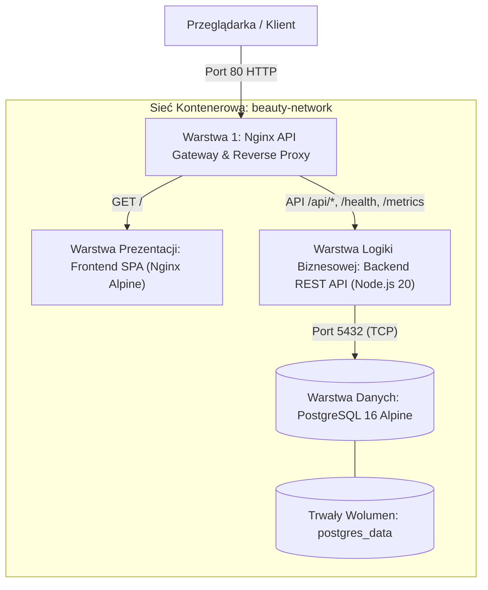
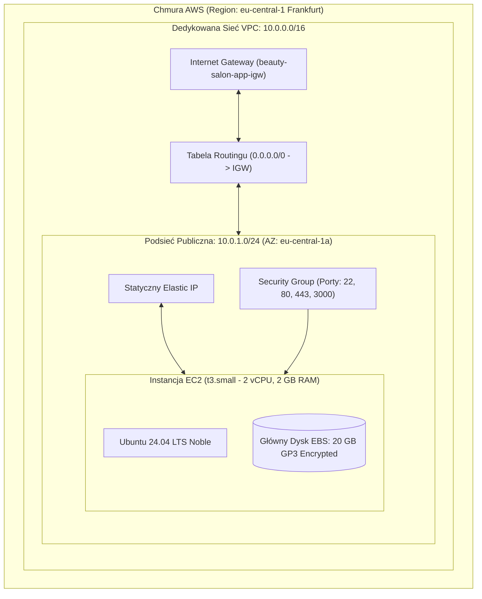
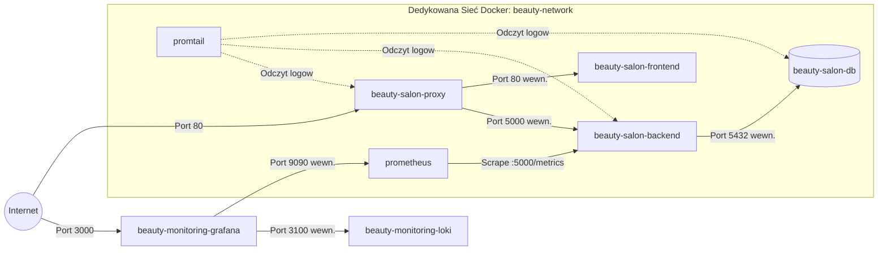
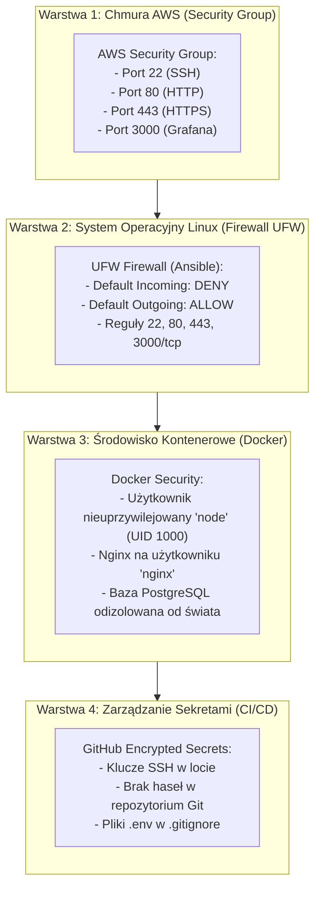
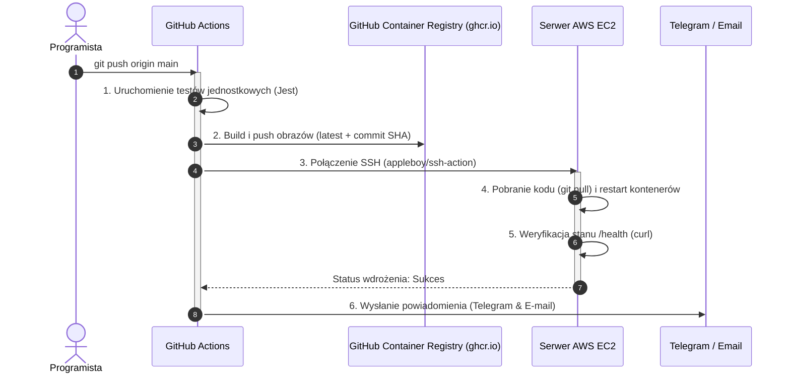

# Architektura Systemu — Beauty Salon App

Niniejszy dokument przedstawia kompleksowy opis architektury systemu internetowego **Beauty Salon App** („Bellezza Studio”), zrealizowanego w ramach projektu inżynierskiego DevOps w oparciu o chmurę **Amazon Web Services (AWS)**, konteneryzację **Docker**, orkiestrację **Docker Compose**, automatyzację **Terraform + Ansible** oraz potok **CI/CD GitHub Actions**.

---

## 1. Trójwarstwowa Architektura Logiczna (3-Tier Architecture)

Aplikacja została zaprojektowana w nowoczesnym, modularnym modelu trójwarstwowym:

### Opis Warstw:
1. **Warstwa Prezentacji (Frontend SPA)**:
   - Lekki, responsywny interfejs użytkownika zrealizowany w HTML5, Tailwind CSS oraz nowoczesnym JavaScript (ES6+).
   - Serwowany za pośrednictwem zoptymalizowanego obrazu `nginx:1.27-alpine` z kompresją gzip zasobów statycznych.
   - Odpowiedzialny za: dynamiczne ładowanie oferty zabiegów, kalkulator cen, interaktywny formularz rezerwacji wizyt oraz natychmiastowe powiadomienia Toast.
2. **Warstwa Logiki Biznesowej (Backend REST API)**:
   - Mikroserwis oparty o **Node.js 20 LTS** oraz framework **Express**.
   - Pula asynchronicznych połączeń z bazą danych (`pg.Pool`).
   - Bezpieczeństwo HTTP: nagłówki `helmet`, polityka `cors`, walidacja danych wejściowych.
   - Wbudowane punkty kontrolne: `/health` (sprawdzenie stanu procesu i bazy) oraz `/metrics` (eksporter metryk Prometheus).
   - Uruchamiany w kontenerze z uprawnieniami nieuprzywilejowanego użytkownika systemowego `node`.
3. **Warstwa Danych (Baza Relacyjna)**:
   - Baza danych **PostgreSQL 16 Alpine**.
   - Relacyjny schemat danych: tabela usług (`services`) oraz tabela rezerwacji (`appointments`) z kluczami obcymi i indeksami.
   - Automatyczna inicjalizacja struktury i danych początkowych przy pierwszym uruchomieniu (`init.sql`).
   - Pełna trwałość danych gwarantowana przez nazwany wolumen Dockera (`beauty_salon_postgres_data`).

---

## 2. Architektura Chmury AWS (Infrastructure as Code)

Infrastruktura w chmurze AWS została zdefiniowana w sposób w 100% deklaratywny przy użyciu narzędzia **Terraform**:

### Kluczowe komponenty chmurowe:
- **VPC (Virtual Private Cloud)**: Izolowana prywatna przestrzeń adresowa `10.0.0.0/16` z włączoną obsługą DNS.
- **Podsieć publiczna**: `10.0.1.0/24` zlokalizowana w strefie dostępności `eu-central-1a`.
- **Internet Gateway & Routing**: Bramka internetowa zapewniająca dwukierunkowy dostęp do sieci Internet dla aktualizacji pakietów i ruchu użytkowników.
- **Elastic IP (EIP)**: Stały, niezmienny publiczny adres IPv4 przypisany do instancji, eliminujący konieczność rekonfiguracji DNS przy restartach maszyny.
- **Instancja EC2 `t3.small`**: 2 vCPU, 2 GB pamięci RAM, 20 GB szyfrowanego dysku GP3 — dobrany z myślą o stabilnej pracy 11 kontenerów aplikacji i monitoringu bez ryzyka błędu Out-Of-Memory.

---

## 3. Topologia Sieci Kontenerowej i Izolacja

Wszystkie mikroserwisy uruchamiane są w ramach dedykowanej sieci wirtualnej Dockera typu bridge: **`beauty-network`**.

### Zasady izolacji sieciowej:
1. **Pojedynczy punkt wejścia**: Port `5432` bazy PostgreSQL **nie jest wystawiony na zewnątrz hosta**. Baza jest dostępna wyłącznie dla backendu wewnątrz sieci kontenerowej `beauty-network`.
2. **Ukrycie portu aplikacji**: Port Node.js `5000` jest dostępny wyłącznie przez Nginx Gateway.
3. **Izolacja monitoringu**: Porty Prometheus (`9090`) i Loki (`3100`) nie są wystawione publicznie — dostęp do nich ma wyłącznie panel Grafana na porcie `3000`.

---

## 4. Dwuwarstwowy Model Bezpieczeństwa (Security Architecture)

Bezpieczeństwo systemu opiera się na strategii **Defense in Depth** (obrona w głąb):

---

## 5. Architektura CI/CD i Wdrażania Bezprzestojowego

Potok ciągłej integracji i dostarczania wykorzystuje platformę **GitHub Actions**:

---

## 6. Architektura Obserwowalności (Prometheus, Grafana, Loki)

Stos obserwowalności zapewnia pełny wgląd w działanie systemu w trzech filarach:
1. **Metryki Maszyny (Host)**: Node Exporter monitoruje stan sprzętowy instancji EC2 (CPU, pamięć RAM, operacje I/O dysku, ruch sieciowy).
2. **Metryki Kontenerów (Docker)**: cAdvisor dostarcza dane o zużyciu zasobów w podziale na poszczególne kontenery w czasie rzeczywistym.
3. **Metryki Aplikacyjne (Code)**: Biblioteka `prom-client` w Node.js mierzy czas trwania żądań (histogram), częstotliwość (RPS) oraz kody błędów.
4. **Logi (Logging)**: Promtail odczytuje strumienie logów z gniazda Dockera i przekazuje je do Loki, co umożliwia przeszukiwanie dzienników za pomocą języka **LogQL** bezpośrednio z poziomu interfejsu Grafana bez konieczności logowania się na serwer przez SSH.

---

## 7. Podsumowanie Decyzji Technicznych

| Decyzja Architektoniczna | Wybrane Rozwiązanie | Uzasadnienie Inżynierskie |
| :--- | :--- | :--- |
| **Chmura publiczna** | AWS (eu-central-1) | Standard branżowy, wysoka niezawodność, serwery w Europie Środkowej (Frankfurt). |
| **Infrastruktura jako Kod** | Terraform + Ansible | Czysty podział: Terraform tworzy infrastrukturę, Ansible konfiguruje system operacyjny. |
| **Rozmiar instancji** | `t3.small` (2 vCPU, 2 GB RAM) | Zapewnia stabilność 11 kontenerom aplikacji i monitoringu (zapobiega OOM-killerowi). |
| **Rejestr kontenerów** | GHCR (`ghcr.io`) | Natywna integracja z GitHub Actions, brak limitów pobierania Docker Hub. |
| **System logów** | Grafana Loki + Promtail | Zużywa ~150 MB RAM zamiast 2-4 GB w ELK Stack; idealny dla środowisk kontenerowych. |
| **Baza danych** | PostgreSQL 16 Alpine | Stabilna, transakcyjna baza relacyjna z automatyczną inicjalizacją i wolumenem trwałym. |
