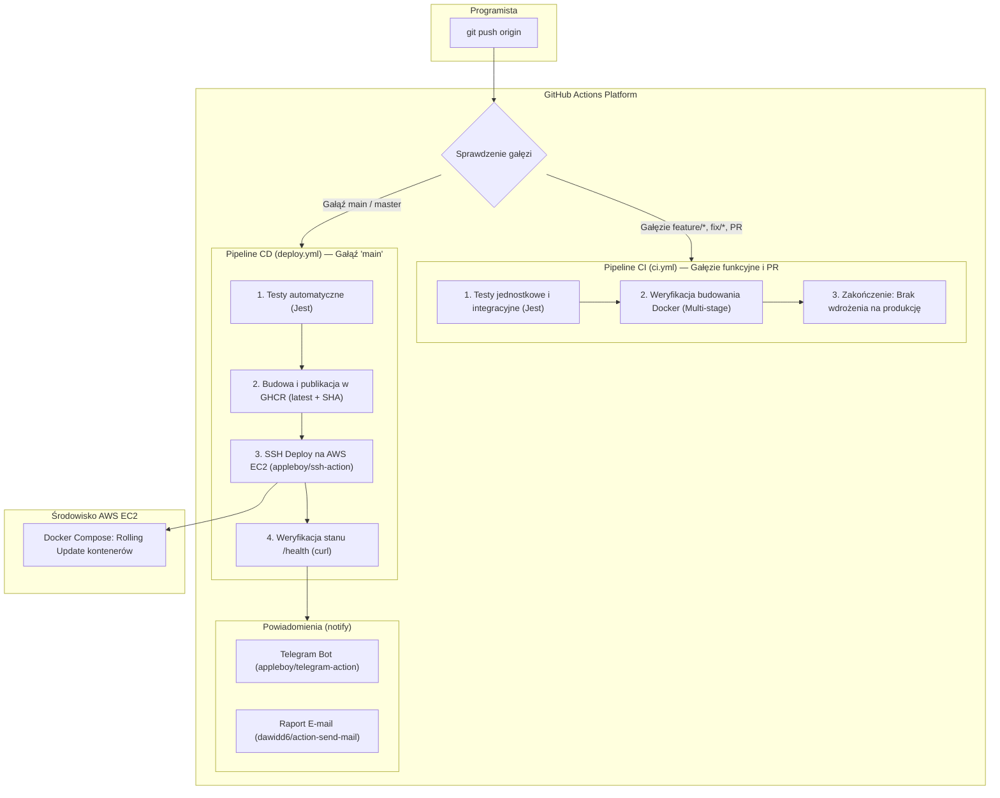

# Przewodnik Pipeline CI/CD w GitHub Actions (Beauty Salon App)

Niniejszy dokument przedstawia kompletną architekturę, konfigurację sekretów oraz scenariusz demonstracji zautomatyzowanego pipeline'u **Ciągłej Integracji (CI)** i **Ciągłego Dostarczania (CD)** w repozytorium **GitHub Actions**.

---

## 1. Architektura i Przepływ Wdrożenia

Zgodnie z wymaganiami projektu dyplomowego procesy CI/CD zostały podzielone na dwa odrębne przepływy pracy:



---

## 2. Podział Pipeline'ów

### A. Pipeline CI (`.github/workflows/ci.yml`)
- **Wyzwalacze**: Wszystkie commity na gałęziach funkcyjnych (`feature/*`, `bugfix/*`) oraz utworzenie lub aktualizacja **Pull Requestów** do gałęzi `main`.
- **Zadanie 1 (`test`)**: Uruchomienie Node.js 20, instalacja zależności (`npm ci`), wykonanie testów jednostkowych i integracyjnych endpointów REST API (`npm test`).
- **Zadanie 2 (`build-check`)**: Weryfikacja poprawności plików `Dockerfile` dla frontendu, backendu i bramy Nginx za pomocą Docker Buildx z buforowaniem warstw w GitHub Actions Cache.
- **Bezpieczeństwo**: Na tym etapie **żadne zmiany nie są publikowane ani wdrażane na serwerze produkcyjnym**.

### B. Pipeline CD (`.github/workflows/deploy.yml`)
- **Wyzwalacz**: Wyłącznie bezpośredni commit lub scalenie (Merge PR) do gałęzi `main`.
- **Krok 1 (`test`)**: Ponowna automatyczna weryfikacja poprawności testów.
- **Krok 2 (`build-and-push`)**: Logowanie do wbudowanego rejestru **GitHub Container Registry (`ghcr.io`)** i publikacja obrazów oznaczonych unikalnym SHA commita oraz tagiem `latest`.
- **Krok 3 (`deploy`)**: Bezpieczne połączenie SSH z serwerem AWS EC2:
  - Pobranie najnowszego kodu (`git pull`).
  - Przebudowa i start kontenerów w tle (`docker compose up -d --build`).
  - Usunięcie nieużywanych obrazów (`docker image prune -f`).
  - Automatyczna sonda sprawdzająca stan zdrowia: `curl -f http://localhost/health` (do 10 prób).
- **Krok 4 (`notify`)**: Wysłanie sformatowanego powiadomienia na Telegram oraz raportu e-mail.

---

## 3. Konfiguracja Sekretów (GitHub Secrets)

Wszystkie poufne dane są zabezpieczone za pomocą mechanizmu **GitHub Encrypted Secrets**. Aby je dodać:
1. Otwórz repozytorium na GitHubie.
2. Przejdź do: **Settings** ➔ **Secrets and variables** ➔ **Actions** ➔ **New repository secret**.

| Nazwa Sekretu | Wymagany? | Opis / Źródło danych |
| :--- | :---: | :--- |
| `EC2_SSH_KEY` | **TAK** | Zawartość prywatnego klucza SSH z Twojego komputera (`cat ~/.ssh/id_ed25519`). |
| `EC2_HOST` | **TAK** | Publiczny adres IP instancji AWS uzyskany z `terraform output public_ip`. |
| `EC2_USER` | *Opcjonalny* | Domyślnie `ubuntu`. |
| `TELEGRAM_BOT_TOKEN` | *Zalecany* | Token bota wygenerowany w Telegramie przez `@BotFather`. |
| `TELEGRAM_CHAT_ID` | *Zalecany* | Identyfikator Twojego czatu w Telegramie (np. z bota `@userinfobot`). |
| `SMTP_SERVER` | *Zalecany* | Adres serwera SMTP (np. `smtp.gmail.com`). |
| `SMTP_PORT` | *Opcjonalny* | Domyślnie `465` (SSL). |
| `SMTP_USERNAME` | *Zalecany* | Login konta e-mail (np. `twoj-login@gmail.com`). |
| `SMTP_PASSWORD` | *Zalecany* | Hasło aplikacji (np. wygenerowane Hasło do aplikacji w Google). |
| `NOTIFICATION_EMAIL`| *Zalecany* | Adres e-mail, na który ma trafiać raport z wdrożenia. |

> [!NOTE]
> Jeżeli sekrety Telegrama lub poczty e-mail nie zostaną skonfigurowane, pipeline **nie ulegnie awarii** — kroki powiadomień zostaną bezpiecznie pominięte bez przerywania wdrożenia.

---

## 4. Szybka Konfiguracja Powiadomień Telegram (2 minuty)

1. Otwórz komunikator Telegram i wyszukaj bota **`@BotFather`**.
2. Wyślij polecenie `/newbot` i postępuj zgodnie z instrukcjami (podaj nazwę i login bota).
3. Skopiuj wygenerowany ciąg znaków (np. `123456789:ABCdefGhIJKlmNoPQRstuVWXyz`) do sekretu `TELEGRAM_BOT_TOKEN`.
4. Wyślij dowolną wiadomość (np. `/start`) do nowo utworzonego bota.
5. Wyszukaj w Telegramie bota **`@userinfobot`**, wyślij mu `/start` i skopiuj swój numer `Id` (np. `987654321`) do sekretu `TELEGRAM_CHAT_ID`.

---

## 5. Scenariusz Demonstracji przed Komisją (Live Demo)

Podczas obrony projektu pokaż komisji działanie pipeline'u w dwóch prostych krokach:

### Krok 1: Pokaz gałęzi funkcyjnej (brak wdrożenia na produkcję)
1. Utwórz nową gałąź w terminalu:
   ```bash
   git checkout -b feature/nowy-naglowek
   ```
2. Zmień drobny detal (np. w pliku `frontend/src/index.html` zmień tytuł lub nagłówek).
3. Zatwierdź i wyślij na GitHuba:
   ```bash
   git commit -am "Aktualizacja naglowka w widoku SPA"
   git push origin feature/nowy-naglowek
   ```
4. Przejdź na GitHubie do zakładki **Actions**:
   - Pokaż, że uruchomił się pipeline **CI**: testy zakończyły się sukcesem, a obrazy Docker przeszły weryfikację.
   - Podkreśl: *„Zgodnie z wymaganiami na tej gałęzi nie dochodzi do wdrożenia na serwerze produkcyjnym.”*

### Krok 2: Scalenie do gałęzi `main` i automatyczne wdrożenie
1. Na GitHubie otwórz **Pull Request** z gałęzi `feature/nowy-naglowek` do `main`.
2. Kliknij **Merge Pull Request**.
3. Obserwuj przebieg pipeline'u **CD (Deploy)**:
   - Testy ➔ Publikacja obrazów w GHCR ➔ Połączenie SSH z AWS ➔ Sprawdzenie `/health`.
4. Pokaż natychmiastowe powiadomienie na telefonie w aplikacji **Telegram** oraz wiadomość w skrzynce **E-mail**.
5. Odśwież stronę aplikacji w przeglądarce (`http://<TWOJ_AWS_IP>`) — wprowadzona zmiana jest widoczna online bez konieczności ręcznego logowania się na serwer!
