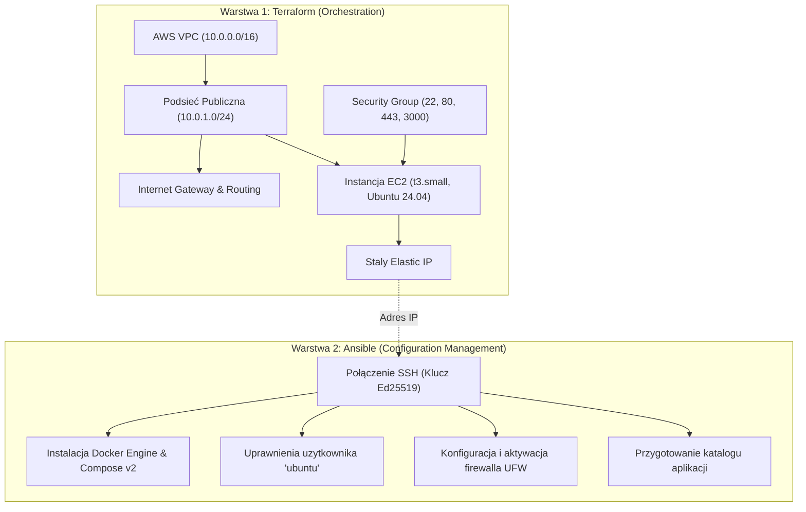

# Przewodnik Wdrożenia Infrastruktury AWS (IaC: Terraform + Ansible)

Niniejszy dokument przedstawia procedurę powołania i konfiguracji kompletnego środowiska produkcyjnego w chmurze **Amazon Web Services (AWS)** dla aplikacji **Beauty Salon App**.

---

## 1. Architektura Infrastruktury i Podział Odpowiedzialności

Zgodnie z najlepszymi praktykami inżynierii DevOps zastosowano ścisły podział odpowiedzialności pomiędzy warstwą orkiestracji chmurowej a warstwą zarządzania konfiguracją:



---

## 2. Wymagania Wstępne

Przed przystąpieniem do uruchomienia upewnij się, że na Twojej maszynie roboczej są zainstalowane:
1. **Terraform** (wersja `>= 1.5.0`).
2. **Ansible** (wersja `>= 2.14`).
3. **AWS CLI** z aktywną autoryzacją (`aws configure`) lub ustawionymi zmiennymi środowiskowymi:
   ```bash
   export AWS_ACCESS_KEY_ID="twoj_access_key"
   export AWS_SECRET_ACCESS_KEY="twoj_secret_key"
   export AWS_DEFAULT_REGION="eu-central-1"
   ```
4. **Klucz SSH Ed25519** znajdujący się w `~/.ssh/id_ed25519.pub`.

---

## 3. Krok po Kroku: Wdrożenie od Zera

### Krok 1: Powołanie zasobów w chmurze AWS (Terraform)

Przejdź do katalogu `terraform/` i zainicjalizuj moduły dostawcy AWS:
```bash
cd terraform
terraform init
```

Zweryfikuj plan wdrożenia (Terraform automatycznie wczyta plik `terraform.tfvars`):
```bash
terraform plan
```

Zaaplikuj konfigurację i utwórz zasoby w chmurze:
```bash
terraform apply -auto-approve
```

Po zakończeniu działania (ok. 1-2 minuty) w terminalu wyświetlą się zmienne wyjściowe (Outputs), m.in.:
- `public_ip` — stały adres IP instancji.
- `ssh_command` — gotowe polecenie do logowania SSH.
- `app_url` — adres URL aplikacji internetowej.
- `grafana_url` — adres panelu monitoringu.
- `ansible_inventory_entry` — wygenerowany wiersz inwentarza.

---

### Krok 2: Automatyczne przekazanie adresu IP do Ansible

Terraform automatycznie generuje gotowy rekord inwentarza dla Ansible. Wystarczy zapisać go do pliku `ansible/inventory.ini`:

```bash
terraform output -raw ansible_inventory_entry > ../ansible/inventory.ini
```

Możesz sprawdzić poprawność pliku inwentarza:
```bash
cat ../ansible/inventory.ini
```

---

### Krok 3: Konfiguracja systemu i oprogramowania (Ansible)

Przejdź do katalogu `ansible/`:
```bash
cd ../ansible
```

Uruchom playbook konfiguracyjny:
```bash
ansible-playbook playbook.yml
```

Playbook wykonuje następujące zadania w sposób całkowicie **idempotentny**:
1. Oczekuje na start demona SSH i odblokowanie menedżera pakietów APT.
2. Instaluje oficjalne pakiety `docker-ce`, `docker-ce-cli`, `containerd.io` oraz `docker-compose-plugin`.
3. Dodaje użytkownika `ubuntu` do grupy `docker`, co eliminuje konieczność używania `sudo`.
4. Konfiguruje reguły zapory sieciowej **UFW**:
   - Port 22/tcp — bezpieczny dostęp SSH.
   - Port 80/tcp — aplikacja WWW (Nginx).
   - Port 443/tcp — szyfrowanie SSL/TLS.
   - Port 3000/tcp — panele monitoringu Grafana.
   - Blokada pozostałego ruchu przychodzącego.
5. Przygotowuje katalog roboczy `/home/ubuntu/beauty-salon-app`.

---

### Krok 4: Weryfikacja gotowości serwera

Możesz uruchomić skrypt weryfikacyjny bezpośrednio z poziomu serwera lub przez SSH:

```bash
# Zalogowanie na serwer za pomoca polecenia wygenerowanego przez Terraform
ssh -i ~/.ssh/id_ed25519 ubuntu@<TWOJ_PUBLICZNY_IP>

# Uruchomienie skryptu sprawdzajacego
bash ~/beauty-salon-app/ansible/verify_server.sh
```

Przykładowy poprawny wynik:
```text
================================================================
  Raport Weryfikacji Gotowosci Serwera AWS EC2 (Beauty Salon)  
================================================================

Sprawdzanie: Usluga systemowa Docker (active)... [PASS]
Sprawdzanie: Polecenie 'docker --version'... [PASS]
Sprawdzanie: Wtyczka Docker Compose v2 ('docker compose')... [PASS]
Sprawdzanie: Uprawnienia uzytkownika do gniazda Docker (/var/run/docker.sock)... [PASS]
Sprawdzanie: Aktywna zapora sieciowa UFW... [PASS]
Sprawdzanie: Port 22/tcp (SSH) w regułach UFW... [PASS]
Sprawdzanie: Port 80/tcp (HTTP) w regułach UFW... [PASS]
Sprawdzanie: Port 443/tcp (HTTPS) w regułach UFW... [PASS]
Sprawdzanie: Port 3000/tcp (Grafana) w regułach UFW... [PASS]
Sprawdzanie: Katalog aplikacji (~/beauty-salon-app)... [PASS]

----------------------------------------------------------------
Szczegoly srodowiska:
System operacyjny: Ubuntu 24.04 LTS
Silnik Docker:     Docker version 27.x.x
Docker Compose:    Docker Compose version v2.x.x
Pamiec RAM:        480M/1.9G (Wolne: 1.4G)
Dysk (Główny):     3.8G/20G (Zajete: 20%, Wolne: 16G)
----------------------------------------------------------------

SUKCES: Wszystkie testy (10/10) zakonczone pomyslnie!
Serwer jest w pelni gotowy do przyjecia deploymentu aplikacji.
```

---

## 4. Likwidacja Infrastruktury (Teardown / Finanse)

W celu uniknięcia dodatkowych kosztów naliczanych przez AWS po zakończeniu demonstracji:

```bash
cd terraform
terraform destroy -auto-approve
```

Terraform w sposób zorganizowany usunie wszystkie przypisane zasoby: instancję EC2, elastyczny adres IP, reguły bezpieczeństwa, bramę internetową oraz dedykowaną sieć VPC.
