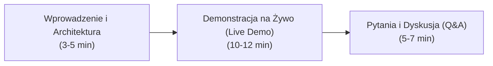

# Scenariusz i Przewodnik do Obrony Projektu Dyplomowego DevOps

Ten dokument to kompletna instrukcja przygotowana z myślą o pomyślnej obronie projektu dyplomowego przed komisją. Zawiera podział czasowy, scenariusz demonstracji na żywo (live demo) oraz odpowiedzi na najczęściej zadawane pytania techniczne.

---

## 1. Struktura i Podział Czasu Prezentacji (Łącznie ok. 20-25 minut)

---

## 2. Część I: Wprowadzenie (3-5 minut)

### Co powiedzieć komisji:
1. **Tytuł i cel projektu**:
   > *"Szanowna Komisjo, celem mojego projektu dyplomowego było zaprojektowanie, zautomatyzowanie i wdrożenie kompletnego środowiska produkcyjnego w chmurze AWS dla wielokontenerowej aplikacji internetowej Beauty Salon App, zgodnie z najlepszymi praktykami inżynierii DevOps."*

2. **Główne wyzwania i osiągnięte rezultaty**:
   * **Infrastruktura jako Kod (IaC)**: Całość infrastruktury w AWS (sieć VPC, reguły Security Groups, maszyna EC2) jest opisana deklaratywnie w **Terraform**. Konfiguracja systemu i środowiska kontenerowego jest zautomatyzowana za pomocą **Ansible**.
   * **Architektura aplikacji**: Architektura trójwarstwowa: Frontend (Nginx), Backend REST API (Node.js/Express) oraz baza danych (PostgreSQL 16).
   * **CI/CD**: Wdrożony dwufazowy pipeline w **GitHub Actions**:
     * Na gałęziach funkcyjnych: testy automatyczne, budowanie i publikacja obrazu.
     * Na gałęzi głównej (`main`): automatyczny deployment na serwer AWS bez przestoju (rolling update) oraz powiadomienia w czasie rzeczywistym na **Telegram** i **E-mail**.
   * **Obserwowalność (Monitoring & Logging)**: Zintegrowany stos **Prometheus + Grafana + cAdvisor + Node Exporter + Grafana Loki**, zapewniający pełny wgląd w zużycie zasobów i logi kontenerów.

---

## 3. Część II: Demonstracja na Żywo / Live Demo (10-12 minut)

Podczas demonstracji przechodzimy przez 4 konkretne kroki:

### Krok 1: Pokaz działającej aplikacji w przeglądarce (2 min)
1. Otwórz w przeglądarce publiczny adres IP instancji AWS: `http://<TWOJ_AWS_IP>`.
2. Pokaż stronę salonu piękności:
   * Formularz rezerwacji wizyty.
   * Dodaj nową wizytę testową (np. *Jan Kowalski*, usługa: *Strzyżenie męskie*).
   * Pokaż, że dane zostały zapisane w bazie PostgreSQL.
3. Otwórz w nowej karcie endpoint stanu zdrowia: `http://<TWOJ_AWS_IP>/health` (zwraca JSON: `{"status": "ok", "database": "connected"}`).

### Krok 2: Prezentacja kodu IaC (2 min)
1. Otwórz edytor kodu w katalogu `terraform/`:
   * Pokaż plik `network.tf` (VPC, podsieci, internet gateway).
   * Pokaż plik `compute.tf` (definicja instancji EC2) i `security.tf` (ograniczenie portów).
2. Pokaż katalog `ansible/`:
   * Pokaż playbook instalujący Dockera i konfigurujący reguły bezpieczeństwa.
   * Podkreśl: *„Infrastrukturę można postawić od zera za pomocą poleceń: `terraform apply` oraz `ansible-playbook -i inventory playbook.yml`.”*

### Krok 3: Pokaz pipeline'u CI/CD i automatycznego wdrożenia (5 min)
*To najważniejszy moment prezentacji, który najbardziej imponuje komisji.*

1. **Test gałęzi funkcyjnej (Feature Branch)**:
   * W terminalu utwórz nową gałąź: `git checkout -b feature/nowy-naglowek`.
   * Zmień drobny element w kodzie (np. dodaj wykrzyknik w tytule strony w `frontend/index.html`).
   * Zrób commit i wypchnij: `git commit -am "Aktualizacja tytulu" && git push origin feature/nowy-naglowek`.
   * Przejdź do zakładki **Actions** w GitHubie:
     * Pokaż komisji, że uruchomił się pipeline **CI**: testy przeszły pomyślnie, obraz Docker został zbudowany i wysłany do rejestru.
     * **Zwróć uwagę**: *„Zgodnie z wymaganiami projektu, na tej gałęzi wdrożenie na serwer produkcyjny NIE zostało uruchomione.”*

2. **Automatyczny deployment na gałęzi `main`**:
   * Otwórz Pull Request do gałęzi `main` i kliknij **Merge**.
   * Przejdź do GitHub Actions:
     * Pokaż uruchomienie pipeline'u **CD (Deploy)**.
     * Zobacz kroki: Testy ➔ Build ➔ SSH Deploy na AWS ➔ HealthCheck.
   * **Powiadomienia**:
     * Otwórz komunikator **Telegram**: pokaż komisji powiadomienie z zieloną ikoną sukcesu, linkiem do commita i czasem wdrożenia.
     * Pokaż skrzynkę **E-mail** z raportem wdrożenia.
   * **Weryfikacja w przeglądarce**:
     * Odśwież stronę `http://<TWOJ_AWS_IP>` — zmiana w tytule jest już widoczna online bez restartu serwera!

### Krok 4: Monitoring i Logi w Grafanie (3 min)
1. Otwórz w przeglądarce adres Grafany: `http://<TWOJ_AWS_IP>:3000`.
2. Pokaż przygotowany dashboard:
   * **Node Exporter**: Wykresy obciążenia CPU, zużycia pamięci RAM i operacji dyskowych maszyny EC2.
   * **cAdvisor**: Metryki kontenerów w czasie rzeczywistym (ile RAM zużywa baza PostgreSQL, ile backend API).
   * **Loki / Explore**: Pokaż sekcję logów — przefiltruj logi kontenera backendu `app-backend` i pokaż zapytania HTTP z poprzednich kroków demo.

---

## 4. Część III: Typowe Pytania Komisji i Gotowe Odpowiedzi (Q&A)

### Pytanie 1: Dlaczego użito zarówno Terraform, jak i Ansible? Czym się różnią?
* **Odpowiedź**: 
  > *„Terraform i Ansible doskonale się uzupełniają. Terraform to narzędzie typu Orchestration (IaC), którego zadaniem jest powołanie do życia samej infrastruktury chmurowej (VPC, maszyny EC2, reguły firewalla). Natomiast Ansible to narzędzie typu Configuration Management, które służy do konfiguracji systemu operacyjnego na powołanej maszynie — zainstalowania Dockera, ustawienia pakietów i zabezpieczeń. Dzięki temu zachowujemy jasny rozdział odpowiedzialności.”*

### Pytanie 2: Co to jest idempotencja i jak została zapewniona w projekcie?
* **Odpowiedź**: 
  > *„Idempotencja to właściwość operacji, która gwarantuje, że wielokrotne jej wykonanie przyniesie dokładnie taki sam rezultat i nie doprowadzi do niespójności środowiska. W Terraformie zapewnia to plik stanu (`terraform.tfstate`) — jeśli zasób już istnieje i jest zgodny z kodem, Terraform go nie modyfikuje. W Ansible każdy moduł (np. instalacja pakietu czy kopiowanie pliku) sprawdza najpierw stan faktyczny i wykonuje akcję tylko wtedy, gdy stan uległ zmianie.”*

### Pytanie 3: Jak zabezpieczone są sekrety i hasła do bazy danych oraz klucze AWS?
* **Odpowiedź**: 
  > *„Żadne poufne dane, klucze AWS czy hasła nie są zapisane w kodzie repozytorium Git. Zastosowano mechanizm `GitHub Encrypted Secrets`. Zmienne takie jak `AWS_ACCESS_KEY_ID`, `EC2_SSH_KEY` czy `POSTGRES_PASSWORD` są wstrzykiwane bezpośrednio do środowiska wykonawczego pipeline'u w locie. Na serwerze produkcyjnym konfiguracja przekazywana jest przez pliki `.env`, które są ignorowane w `.gitignore`.”*

### Pytanie 4: Dlaczego wybrano Prometheus i Grafanę zamiast np. ELK Stack?
* **Odpowiedź**: 
  > *„Prometheus i Grafana to de facto branżowy standard monitoringu kontenerowego. W porównaniu z tradycyjnym stosem ELK (Elasticsearch, Logstash, Kibana), stos Prometheus + Loki zużywa ułamek zasobów pamięci RAM (Elasticsearch wymaga minimum 2-4 GB na sam start). Loki nie indeksuje pełnego tekstu, a jedynie etykiety metadanych, co czyni go niezwykle lekkim i wydajnym dla środowisk opartych o kontenery.”*

### Pytanie 5: Co stanie się w przypadku awarii jednego z kontenerów backendu?
* **Odpowiedź**: 
  > *„W konfiguracji `docker-compose.yml` zastosowano politykę `restart: always` oraz healthchecki. Jeśli proces w kontenerze ulegnie awarii, demon Dockera automatycznie podejmie próbę jego restartu. Dodatkowo reverse proxy (Nginx) może przekierowywać ruch do drugiej repliki backendu, co minimalizuje przestój dla użytkownika końcowego.”*
