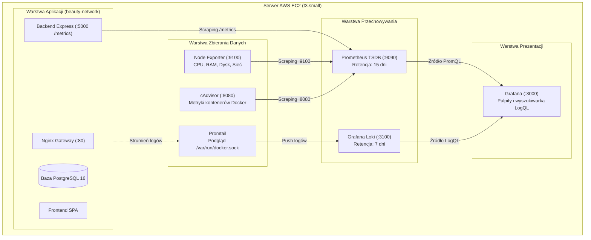

# Przewodnik Monitoringu i Obserwowalności (Prometheus, Grafana, Loki)

Niniejszy dokument przedstawia architekturę, konfigurację oraz sposób wykorzystania kompletnego stosu **obserwowalności (Observability)** w projekcie **Beauty Salon App**.

---

## 1. Architektura Systemu Monitoringu i Logowania

Zgodnie z wymogami projektu inżynierskiego DevOps wdrożono dwutorowy system obserwowalności:
- **Metryki numeryczne**: oparte o standard czasowych baz danych (TSDB) **Prometheus** zbierający dane z trzech warstw: systemu operacyjnego, silnika Docker oraz kodu aplikacji.
- **Dzienniki zdarzeń (Logi)**: oparte o lekki, nowoczesny stos **Grafana Loki + Promtail**, który nie wymaga ogromnych zasobów pamięci RAM (w przeciwieństwie do tradycyjnego ELK Stack).
- **Wizualizacja**: pojedynczy zintegrowany interfejs **Grafana** dostępny na porcie `3000`.



---

## 2. Zestawienie Komponentów i Portów

| Komponent | Obraz Docker | Port wewnętrzny | Opis i odpowiedzialność |
| :--- | :--- | :---: | :--- |
| **Prometheus** | `prom/prometheus:v2.54.1` | `9090` | Pobieranie i przechowywanie metryk czasowych (TSDB). |
| **Node Exporter** | `prom/node-exporter:v1.8.2` | `9100` | Metryki systemowe serwera Linux (obciążenie CPU, RAM, dysk). |
| **cAdvisor** | `gcr.io/cadvisor/cadvisor:v0.49.1` | `8080` | Analiza zużycia zasobów przez każdy kontener Dockera. |
| **Grafana Loki** | `grafana/loki:3.1.0` | `3100` | Indeksowanie i przeszukiwanie dzienników logów. |
| **Promtail** | `grafana/promtail:3.1.0` | `9080` | Agent przesyłający logi kontenerów ze strumieni stdout/stderr. |
| **Grafana** | `grafana/grafana:11.2.0` | `3000` | Wizualizacja wskaźników i interaktywne dashboardy. |

---

## 3. Kluczowe Metryki i Zapytania PromQL

### A. Metryki Sprzętowe i Systemowe (Node Exporter)
1. **Zużycie procesora (CPU %)**:
   ```promql
   100 - (avg by (instance) (rate(node_cpu_seconds_total{mode="idle"}[1m])) * 100)
   ```
2. **Zużycie pamięci RAM (%)**:
   ```promql
   ((node_memory_MemTotal_bytes - node_memory_MemAvailable_bytes) / node_memory_MemTotal_bytes) * 100
   ```
3. **Zajętość dysku głównego Root (%)**:
   ```promql
   100 - ((node_filesystem_avail_bytes{mountpoint="/"} * 100) / node_filesystem_size_bytes{mountpoint="/"})
   ```

### B. Metryki Kontenerowe (cAdvisor)
1. **Zużycie procesora w podziale na kontenery**:
   ```promql
   rate(container_cpu_usage_seconds_total{name!=""}[1m]) * 100
   ```
2. **Pamięć RAM zużywana przez kontenery (w bajtach)**:
   ```promql
   container_memory_usage_bytes{name!=""}
   ```

### C. Metryki Aplikacyjne (Node.js REST API)
1. **Liczba żądań HTTP na sekundę (RPS)**:
   ```promql
   sum by (route, method) (rate(beauty_salon_http_requests_total[1m]))
   ```
2. **Czas odpowiedzi endpointów (Opóźnienie P95 w sekundach)**:
   ```promql
   histogram_quantile(0.95, sum by (le) (rate(beauty_salon_http_request_duration_seconds_bucket[1m])))
   ```

---

## 4. Przeszukiwanie Logów w Grafana Loki (LogQL)

W interfejsie Grafana przejdź do zakładki **Explore** i wybierz źródło danych **Loki**:

1. **Podgląd logów wybranego kontenera (np. backend API)**:
   ```logql
   {container="beauty-salon-backend"}
   ```
2. **Wyszukanie błędów w logach backendu**:
   ```logql
   {container="beauty-salon-backend"} |= "error"
   ```
3. **Filtrowanie zapytań do bazy danych PostgreSQL**:
   ```logql
   {container="beauty-salon-db"} |= "SELECT"
   ```
4. **Wszystkie logi aplikacji w czasie rzeczywistym**:
   ```logql
   {job=~"docker-.*"}
   ```

---

## 5. Dostęp do Panelu Grafana

1. Otwórz w przeglądarce adres: `http://<TWOJ_PUBLICZNY_IP_AWS>:3000`.
2. Domyślne dane logowania (zdefiniowane w konfiguracji):
   * **Login**: `admin`
   * **Hasło**: `admin`
3. Gotowy pulpit nawigacyjny:
   * Dzięki wbudowanemu mechanizmowi **Grafana Provisioning** nie ma potrzeby ręcznego importu.
   * Dashboard **„Beauty Salon App — Panel Monitoringu i Obserwowalności”** otwiera się automatycznie jako strona główna.

---

## 6. Uruchomienie i Zarządzanie Stosem

Stos monitoringu uruchamiany jest obok głównej aplikacji w tej samej sieci `beauty-network`:

```bash
# Uruchomienie stosu monitoringu w tle
cd monitoring
docker compose -f docker-compose.monitoring.yml up -d

# Sprawdzenie statusu kontenerow monitoringu
docker compose -f docker-compose.monitoring.yml ps

# Zatrzymanie stosu monitoringu
docker compose -f docker-compose.monitoring.yml down
```

---

## 7. Scenariusz Demonstracji dla Komisji (3 minuty)

1. Otwórz adres `http://<TWOJ_IP>:3000` w przeglądarce.
2. Pokaż pulpit **Beauty Salon App**:
   * Zwróć uwagę na sekcję **Wskaźniki Systemowe**: wskaż komisji, że serwer zużywa poniżej 30% CPU i ok. 1.2 GB RAM (bezpieczny zapas dla maszyny `t3.small`).
   * Pokaż sekcję **Kontenery Dockera**: wskaż, ile RAM zużywa baza `beauty-salon-db`, a ile backend `beauty-salon-backend`.
3. Wygeneruj ruch w aplikacji:
   * Przejdź na stronę salonu `http://<TWOJ_IP>` i wykonaj 2 rezerwacje online.
   * Wróć do Grafany — pokaż skok na wykresie **Ruch HTTP do API (RPS)** oraz pomiar opóźnienia **P95 Latency**.
4. Pokaż sekcję **Loki (Dzienniki Logów)**:
   * Rozwiń panel logów na dole strony — wskaż zarejestrowane zapytania `POST /api/appointments` oraz potwierdzenie połączenia z PostgreSQL bez konieczności logowania się po SSH na serwer.
